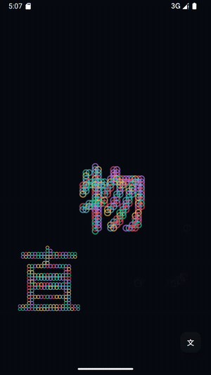
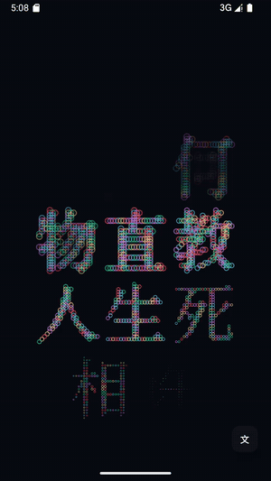

# 点字成涟 GlyphRipple

把文字变成点阵，每个点是一圈扩散的涟漪。

> 我总想在宇宙中寻求意义，他却不予以理睬。

| 逐字随机 | 整句排版 · 经典点阵 |
| :---: | :---: |
|  |  |

## 玩法

- 打开后文字逐个出现，每个字由一片涟漪组成，从字心向外荡开，然后淡去。
- 手指在屏幕上点按或滑动，会留下一串涟漪，支持多指。
- 点右下角的「文」打开设置：
  - **文字**：输入任意内容，汉字、英文、数字、emoji 都可以。
  - **排布**：逐字随机落在屏幕各处，或者整句排好、像波浪一样扫过。
  - **字形**：系统字体，或者 HZK24 宋体点阵（老式点阵字库的味道）。
  - **配色**：霓虹、深海、余烬、水墨，以及 2015 年初版的配色。
  - **速度**、**密度**（每个字的点阵行数）、**循环播放**。
- 退到后台时动画暂停，回来后继续。

## 原理

1. **文字 → 点阵**。两种来源，实现同一个 `GlyphSource` 接口：
   - 系统字体：把字符画到一张只有几十像素高的小位图上，一个像素对应一个格子，不透明度过阈值就算有墨。
   - HZK24：GB2312 点阵字库，每字 24×24、占 72 字节，按区位码算出偏移后逐位读出。字库里没有的字符自动回退到系统字体。
2. **点阵 → 画布坐标**。`TextLayout` 把每个字的墨点换算成屏幕上的圆心，逐字随机摆放或整句换行居中。
3. **圆心 → 涟漪**。`TextPlayer` 按节奏把字交给 `RippleField`；每个墨点是一个圆环，半径从 0 涨到略大于一个格子，同时逐渐变透明，消散后移除。
4. **绘制**。Compose `Canvas` 跟随屏幕刷新率逐帧重绘，动画按真实经过的时间推进，快慢与帧率无关。

## 代码结构

```
app/src/main/java/com/lq/glyphripple/
├── core/     纯 Kotlin，不依赖 Android，有单元测试
│   ├── GlyphGrid.kt     点阵与 GlyphSource 接口
│   ├── Hzk24Font.kt     HZK24 字库解析
│   ├── Graphemes.kt     按用户可见字符拆分文本
│   ├── TextLayout.kt    逐字随机 / 整句排版
│   ├── RippleField.kt   涟漪的存储与推进
│   └── TextPlayer.kt    出字节奏与循环
├── glyph/    SystemFontGlyphSource：用系统字体生成点阵
└── ui/       Compose 界面：画布、触摸、设置面板、配色
```

## 构建

需要 JDK 17 和 Android SDK（compileSdk 37，最低支持 Android 7.0）。

```bash
./gradlew installDebug
```

```bash
./gradlew testDebugUnitTest
```

## 历史

- 2015：初版。
- 2017：迁移到 Android Studio。
- 2020：重构为自定义 View + Lifecycle。
- 2026：用 Kotlin 和 Jetpack Compose 重写，支持任意文字、多种排布与配色；项目由「文字控 WenziKong」更名为「点字成涟 GlyphRipple」。
